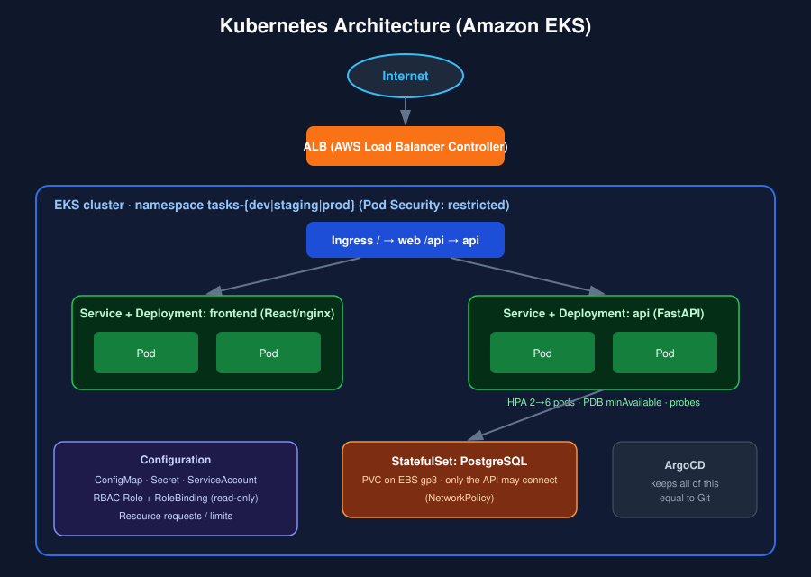
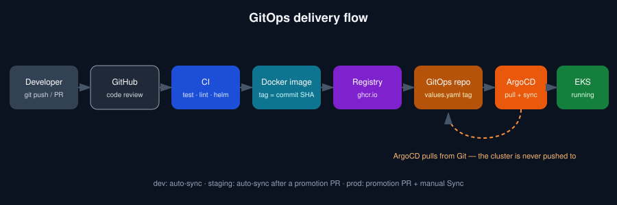
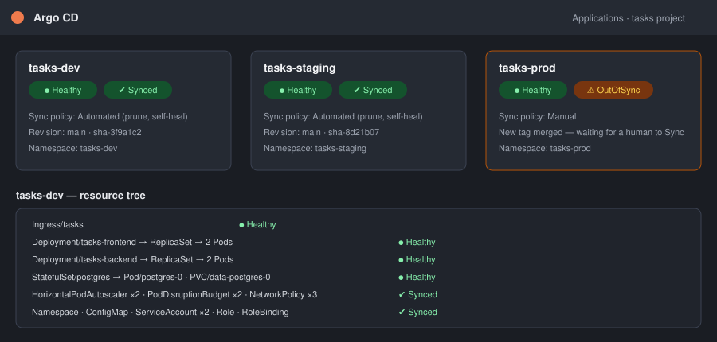
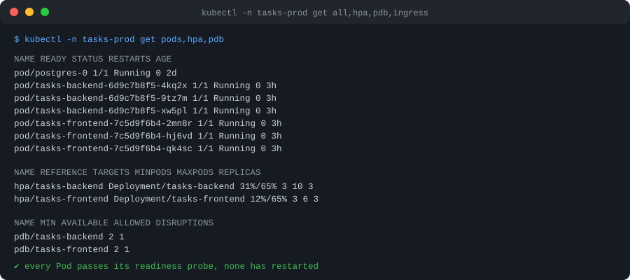

# Kubernetes + GitOps Platform

[](.github/workflows/ci.yml)
[](infra/eksctl/cluster.yaml)
[](helm/tasks-platform)
[](gitops)
[](LICENSE)

[](README.pt-br.md)

A small three-tier app — **React → FastAPI → PostgreSQL** — running on **Kubernetes** and delivered the GitOps way: nobody runs `kubectl apply` against a cluster. A commit becomes a container image, the image tag is written to Git, and **Argo CD** pulls that change into **Amazon EKS**.

## What this project demonstrates

Every Kubernetes building block you would expect in a real service, wired together and explained:

| Concept | Where to find it | Why it matters here |
|---|---|---|
| **Namespace** | [`namespace.yaml`](helm/tasks-platform/templates/namespace.yaml) | one per environment, with Pod Security `restricted` enforced |
| **Deployment** | [`backend.yaml`](helm/tasks-platform/templates/backend.yaml), [`frontend.yaml`](helm/tasks-platform/templates/frontend.yaml) | zero-downtime rolling updates (`maxUnavailable: 0`) |
| **Service** | same files | stable in-cluster address for each tier |
| **Ingress** | [`ingress.yaml`](helm/tasks-platform/templates/ingress.yaml) | `/` → React, `/api` → FastAPI, served by an AWS ALB |
| **ConfigMap** | [`configmap.yaml`](helm/tasks-platform/templates/configmap.yaml) | non-sensitive settings; its hash triggers a rollout when it changes |
| **Secret** | [`create-db-secret.sh`](scripts/create-db-secret.sh) | credentials are created outside Git, never committed |
| **RBAC** | [`rbac.yaml`](helm/tasks-platform/templates/rbac.yaml), [`serviceaccount.yaml`](helm/tasks-platform/templates/serviceaccount.yaml) | read-only Role for developers; pods get no API token |
| **Requests / Limits** | `resources:` in each workload | scheduler gets real numbers; HPA percentages mean something |
| **Liveness probe** | `/health/live` | restarts a stuck process — never checks the database on purpose |
| **Readiness probe** | `/health/ready` | pulls a pod out of the Service when the database is unreachable |
| **HPA** | in `backend.yaml` / `frontend.yaml` | scales on CPU between min and max replicas |
| **PDB** | same files | node drains can never take the last replicas down |
| **NetworkPolicy** | [`networkpolicy.yaml`](helm/tasks-platform/templates/networkpolicy.yaml) | default-deny; only the API can reach PostgreSQL |
| **StatefulSet + PVC** | [`postgres.yaml`](helm/tasks-platform/templates/postgres.yaml) | stable identity and an EBS gp3 volume for the database |
| **Helm** | [`helm/tasks-platform`](helm/tasks-platform) | one chart, three environments, values per environment |
| **EKS** | [`infra/eksctl/cluster.yaml`](infra/eksctl/cluster.yaml) | IRSA, EBS CSI, metrics-server, NetworkPolicy enforcement |
| **Argo CD** | [`gitops/`](gitops) | app-of-apps, auto-sync for dev/staging, manual sync for prod |

## Architecture



```
React
  ↓
API Python/FastAPI
  ↓
PostgreSQL
```

## The delivery flow (the actual differentiator)



```
Developer → GitHub → CI → Docker Image → Container Registry → GitOps Repository → Argo CD → EKS
```

1. **Developer** opens a pull request. **CI** runs `ruff`, `pytest`, `vitest`, `helm lint`, `helm template | kubeconform` and builds both images.
2. After merge, the **release** workflow builds the images, pushes them to **GitHub Container Registry** tagged with the commit SHA, then commits that tag into `gitops/environments/dev/values.yaml`.
3. **Argo CD** (running inside the cluster) sees the new commit and syncs `tasks-dev` on its own.
4. To promote, run the **Promote image tag** workflow: it opens a pull request that copies the tag to `staging` or `prod`. The PR review *is* the approval.
5. `prod` is deliberately **manual-sync**: Argo CD shows it as *OutOfSync* until a human presses Sync.

| Environment | Namespace | Argo CD sync | How a change arrives |
|---|---|---|---|
| dev | `tasks-dev` | automatic (prune + self-heal) | every merge to `main` |
| staging | `tasks-staging` | automatic | promotion pull request |
| prod | `tasks-prod` | **manual** | promotion pull request + human Sync |





> The two images above are illustrations of what the Argo CD UI and `kubectl` show when the platform is healthy; they are not captures of a live cluster.

## Repository structure

```
k8s-gitops-platform/
├── app/
│   ├── backend/              # FastAPI + SQLAlchemy, pytest, Dockerfile
│   └── frontend/             # React (Vite), vitest, nginx Dockerfile
├── helm/tasks-platform/      # the Helm chart (every Kubernetes resource lives here)
├── gitops/
│   ├── argocd/               # AppProject + dev/staging/prod Applications
│   ├── bootstrap/            # root-app.yaml — the only object applied by hand
│   └── environments/         # values.yaml per environment (CI writes the image tag here)
├── infra/
│   ├── eksctl/cluster.yaml   # the EKS cluster
│   └── k8s/                  # gp3 StorageClass
├── kind/                     # local cluster config + values
├── scripts/                  # kind-up, create-db-secret, install-alb-controller, bootstrap-argocd
├── .github/workflows/        # ci.yml, release.yml, promote.yml
├── docker-compose.yml        # run the 3 tiers without Kubernetes
└── docs/images/
```

## Technologies used

- **Kubernetes** on **Amazon EKS** (managed node group, EBS CSI, AWS Load Balancer Controller, VPC CNI NetworkPolicy)
- **Helm 3** and **Argo CD** (app-of-apps, AppProject)
- **GitHub Actions** and **GitHub Container Registry**
- **Python 3.12 / FastAPI / SQLAlchemy** · **React 18 / Vite** · **PostgreSQL 16**
- **kind** for local clusters, **Docker Compose** for a quick local run

## Getting started

### Option 1 — just run the app (Docker Compose)

```bash
git clone https://github.com/biagasparino/k8s-gitops-platform.git
cd k8s-gitops-platform
docker compose up --build
```

Open http://localhost:8080 (API docs at http://localhost:8000/docs).

### Option 2 — Kubernetes on your laptop (kind + Helm)

Requires `docker`, `kind`, `kubectl`, `helm`.

```bash
./scripts/kind-up.sh
```

It creates a 3-node cluster, installs ingress-nginx, builds and loads the images, creates the database Secret with a random password and installs the chart. Open http://localhost:8080.

### Option 3 — the full GitOps setup on EKS

Requires `aws` (authenticated), `eksctl`, `kubectl`, `helm`.

```bash
# 1. Create the cluster (~15 min)
eksctl create cluster -f infra/eksctl/cluster.yaml

# 2. gp3 as the default storage class (PostgreSQL volume)
kubectl annotate storageclass gp2 storageclass.kubernetes.io/is-default-class-
kubectl apply -f infra/k8s/storageclass-gp3.yaml

# 3. Teach Kubernetes to create AWS load balancers from Ingress objects
./scripts/install-alb-controller.sh

# 4. Install Argo CD, create the Secrets (random passwords) and hand control to Git
./scripts/bootstrap-argocd.sh
```

After step 4 you never touch the cluster again: push to `main`, watch Argo CD sync `tasks-dev`, promote with the **Promote image tag** workflow.

Before the first run: in GitHub → *Packages*, make the `tasks-backend` and `tasks-frontend` images **public** (or add an `imagePullSecret`), and enable *Settings → Actions → General → Allow GitHub Actions to create pull requests*.

> ⚠️ **Cost:** an EKS control plane, two `t3.medium` nodes, NAT gateway and ALBs are billed hourly. When you are done: `eksctl delete cluster -f infra/eksctl/cluster.yaml`.

## Try it: see Kubernetes doing its job

```bash
# Self-healing: delete a pod, a new one appears
kubectl -n tasks-dev delete pod -l app.kubernetes.io/component=backend --wait=false
kubectl -n tasks-dev get pods -w

# GitOps self-heal: change the cluster by hand, Argo CD puts it back
kubectl -n tasks-dev scale deploy/tasks-backend --replicas=7     # reverted within minutes

# Autoscaling: generate load and watch the HPA add pods
kubectl -n tasks-dev get hpa -w

# Readiness vs liveness: take the database away
kubectl -n tasks-dev scale sts/postgres --replicas=0
kubectl -n tasks-dev get pods        # API pods go NotReady (removed from the Service) but are NOT restarted
kubectl -n tasks-dev scale sts/postgres --replicas=1

# Disruption budget: a node drain respects minAvailable
kubectl drain <node> --ignore-daemonsets --delete-emptydir-data
```

## Configuration

Backend settings (see [`app/backend/.env.example`](app/backend/.env.example)). In Kubernetes the non-sensitive ones come from the `tasks-config` ConfigMap and the credentials from the `tasks-db-credentials` Secret.

| Variable | Description |
|---|---|
| `DB_HOST`, `DB_PORT`, `DB_NAME` | PostgreSQL address (ConfigMap in Kubernetes) |
| `DB_USER`, `DB_PASSWORD` | credentials (Secret in Kubernetes — never committed) |
| `DATABASE_URL` | optional full URL; takes precedence (tests use SQLite) |
| `LOG_LEVEL` | Python log level |
| `APP_VERSION` | shown by `/api/info`, set to the image tag by Helm |

Chart options are documented in [`helm/tasks-platform/values.yaml`](helm/tasks-platform/values.yaml); each environment overrides only what differs in [`gitops/environments/<env>/values.yaml`](gitops/environments).

**Secrets:** this repository contains no credentials. For production, replace `create-db-secret.sh` with [External Secrets Operator](https://external-secrets.io/) or Sealed Secrets, and use Amazon RDS (`postgres.enabled: false`, `database.host`) instead of an in-cluster database.

## Testing & code quality

```bash
cd app/backend  && pip install -r requirements-dev.txt && ruff check . && pytest
cd app/frontend && npm ci && npm test && npm run build
helm lint helm/tasks-platform -f gitops/environments/dev/values.yaml
helm template tasks helm/tasks-platform -n tasks-dev -f gitops/environments/dev/values.yaml | kubeconform -strict
```

The same checks run on every pull request ([`ci.yml`](.github/workflows/ci.yml)).

## Contributing

1. Fork the repository and branch from `main`.
2. Run the checks above locally.
3. Open a pull request — CI validates the app, the chart and the images.
4. Changes under `gitops/environments/prod/` require an owner's review ([`CODEOWNERS`](.github/CODEOWNERS)).

See [CHANGELOG.md](CHANGELOG.md) for the release history.

## License

Distributed under the [MIT License](LICENSE).
