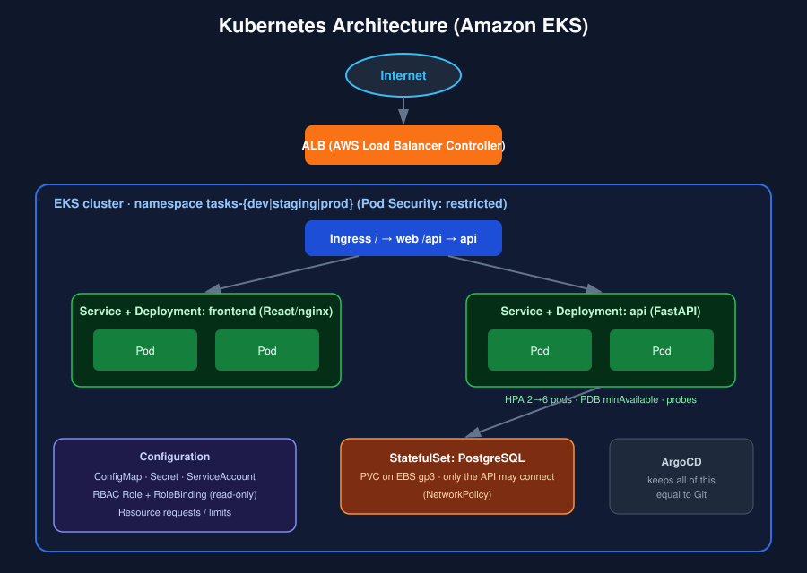
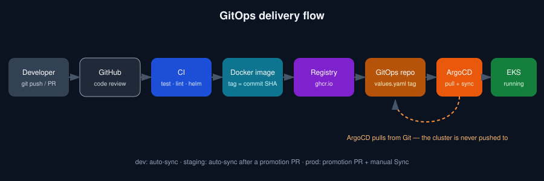
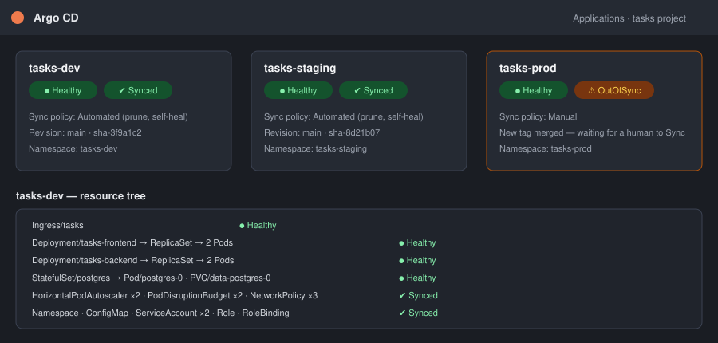
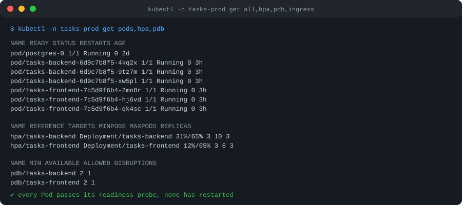

# Plataforma Kubernetes + GitOps

[](.github/workflows/ci.yml)
[](infra/eksctl/cluster.yaml)
[](helm/tasks-platform)
[](gitops)
[](LICENSE)

[](README.md)

Uma aplicação simples em três camadas — **React → FastAPI → PostgreSQL** — rodando em **Kubernetes** e entregue do jeito GitOps: ninguém roda `kubectl apply` direto em um cluster. Um commit vira uma imagem de container, a tag da imagem é escrita no Git, e o **Argo CD** puxa essa mudança para o **Amazon EKS**.

## O que este projeto demonstra

Todos os blocos de Kubernetes que você esperaria em um serviço real, conectados e explicados:

| Conceito | Onde encontrar | Por que importa aqui |
|---|---|---|
| **Namespace** | [`namespace.yaml`](helm/tasks-platform/templates/namespace.yaml) | um por ambiente, com Pod Security `restricted` aplicado |
| **Deployment** | [`backend.yaml`](helm/tasks-platform/templates/backend.yaml), [`frontend.yaml`](helm/tasks-platform/templates/frontend.yaml) | atualizações rolling sem downtime (`maxUnavailable: 0`) |
| **Service** | mesmos arquivos | endereço estável dentro do cluster para cada camada |
| **Ingress** | [`ingress.yaml`](helm/tasks-platform/templates/ingress.yaml) | `/` → React, `/api` → FastAPI, servido por um ALB da AWS |
| **ConfigMap** | [`configmap.yaml`](helm/tasks-platform/templates/configmap.yaml) | configurações não sensíveis; o hash dele dispara um rollout quando muda |
| **Secret** | [`create-db-secret.sh`](scripts/create-db-secret.sh) | credenciais criadas fora do Git, nunca commitadas |
| **RBAC** | [`rbac.yaml`](helm/tasks-platform/templates/rbac.yaml), [`serviceaccount.yaml`](helm/tasks-platform/templates/serviceaccount.yaml) | Role somente leitura para desenvolvedores; pods sem token da API |
| **Requests / Limits** | `resources:` em cada workload | o scheduler recebe números reais; as porcentagens do HPA passam a fazer sentido |
| **Liveness probe** | `/health/live` | reinicia um processo travado — nunca consulta o banco, de propósito |
| **Readiness probe** | `/health/ready` | tira o pod do Service quando o banco está inacessível |
| **HPA** | em `backend.yaml` / `frontend.yaml` | escala por CPU entre um mínimo e um máximo de réplicas |
| **PDB** | mesmos arquivos | drenar um nó nunca derruba as últimas réplicas |
| **NetworkPolicy** | [`networkpolicy.yaml`](helm/tasks-platform/templates/networkpolicy.yaml) | negar por padrão; só a API alcança o PostgreSQL |
| **StatefulSet + PVC** | [`postgres.yaml`](helm/tasks-platform/templates/postgres.yaml) | identidade estável e um volume EBS gp3 para o banco |
| **Helm** | [`helm/tasks-platform`](helm/tasks-platform) | um chart, três ambientes, values por ambiente |
| **EKS** | [`infra/eksctl/cluster.yaml`](infra/eksctl/cluster.yaml) | IRSA, EBS CSI, metrics-server, NetworkPolicy ativa |
| **Argo CD** | [`gitops/`](gitops) | app-of-apps, sync automático em dev/staging, manual em prod |

## Arquitetura



```
React
  ↓
API Python/FastAPI
  ↓
PostgreSQL
```

## O fluxo de entrega (o verdadeiro diferencial)



```
Developer → GitHub → CI → Docker Image → Container Registry → GitOps Repository → Argo CD → EKS
```

1. A pessoa desenvolvedora abre um pull request. A **CI** roda `ruff`, `pytest`, `vitest`, `helm lint`, `helm template | kubeconform` e builda as duas imagens.
2. Após o merge, o workflow de **release** builda as imagens, envia para o **GitHub Container Registry** com a tag do SHA do commit e faz commit dessa tag em `gitops/environments/dev/values.yaml`.
3. O **Argo CD** (rodando dentro do cluster) percebe o novo commit e sincroniza o `tasks-dev` sozinho.
4. Para promover, rode o workflow **Promote image tag**: ele abre um pull request que copia a tag para `staging` ou `prod`. A revisão do PR *é* a aprovação.
5. O `prod` é **sync manual** de propósito: o Argo CD o mostra como *OutOfSync* até que uma pessoa clique em Sync.

| Ambiente | Namespace | Sync do Argo CD | Como a mudança chega |
|---|---|---|---|
| dev | `tasks-dev` | automático (prune + self-heal) | todo merge em `main` |
| staging | `tasks-staging` | automático | pull request de promoção |
| prod | `tasks-prod` | **manual** | pull request de promoção + Sync humano |





> As duas imagens acima são ilustrações do que a interface do Argo CD e o `kubectl` mostram quando a plataforma está saudável; não são capturas de um cluster real.

## Estrutura do repositório

```
k8s-gitops-platform/
├── app/
│   ├── backend/              # FastAPI + SQLAlchemy, pytest, Dockerfile
│   └── frontend/             # React (Vite), vitest, Dockerfile com nginx
├── helm/tasks-platform/      # o chart Helm (todo recurso Kubernetes mora aqui)
├── gitops/
│   ├── argocd/               # AppProject + Applications dev/staging/prod
│   ├── bootstrap/            # root-app.yaml — o único objeto aplicado à mão
│   └── environments/         # values.yaml por ambiente (a CI escreve a tag da imagem aqui)
├── infra/
│   ├── eksctl/cluster.yaml   # o cluster EKS
│   └── k8s/                  # StorageClass gp3
├── kind/                     # config do cluster local + values
├── scripts/                  # kind-up, create-db-secret, install-alb-controller, bootstrap-argocd
├── .github/workflows/        # ci.yml, release.yml, promote.yml
├── docker-compose.yml        # roda as 3 camadas sem Kubernetes
└── docs/images/
```

## Tecnologias utilizadas

- **Kubernetes** no **Amazon EKS** (node group gerenciado, EBS CSI, AWS Load Balancer Controller, NetworkPolicy no VPC CNI)
- **Helm 3** e **Argo CD** (app-of-apps, AppProject)
- **GitHub Actions** e **GitHub Container Registry**
- **Python 3.12 / FastAPI / SQLAlchemy** · **React 18 / Vite** · **PostgreSQL 16**
- **kind** para clusters locais, **Docker Compose** para uma execução local rápida

## Como começar

### Opção 1 — só rodar a aplicação (Docker Compose)

```bash
git clone https://github.com/biagasparino/k8s-gitops-platform.git
cd k8s-gitops-platform
docker compose up --build
```

Abra http://localhost:8080 (documentação da API em http://localhost:8000/docs).

### Opção 2 — Kubernetes no seu notebook (kind + Helm)

Requer `docker`, `kind`, `kubectl`, `helm`.

```bash
./scripts/kind-up.sh
```

Ele cria um cluster de 3 nós, instala o ingress-nginx, builda e carrega as imagens, cria o Secret do banco com senha aleatória e instala o chart. Abra http://localhost:8080.

### Opção 3 — o setup GitOps completo no EKS

Requer `aws` (autenticado), `eksctl`, `kubectl`, `helm`.

```bash
# 1. Crie o cluster (~15 min)
eksctl create cluster -f infra/eksctl/cluster.yaml

# 2. gp3 como storage class padrão (volume do PostgreSQL)
kubectl annotate storageclass gp2 storageclass.kubernetes.io/is-default-class-
kubectl apply -f infra/k8s/storageclass-gp3.yaml

# 3. Ensine o Kubernetes a criar load balancers da AWS a partir de objetos Ingress
./scripts/install-alb-controller.sh

# 4. Instale o Argo CD, crie os Secrets (senhas aleatórias) e entregue o controle ao Git
./scripts/bootstrap-argocd.sh
```

Depois do passo 4 você nunca mais mexe no cluster: faça push na `main`, veja o Argo CD sincronizar o `tasks-dev` e promova com o workflow **Promote image tag**.

Antes da primeira execução: no GitHub → *Packages*, deixe as imagens `tasks-backend` e `tasks-frontend` **públicas** (ou adicione um `imagePullSecret`), e ative *Settings → Actions → General → Allow GitHub Actions to create pull requests*.

> ⚠️ **Custo:** o control plane do EKS, dois nós `t3.medium`, NAT gateway e ALBs são cobrados por hora. Ao terminar: `eksctl delete cluster -f infra/eksctl/cluster.yaml`.

## Experimente: veja o Kubernetes trabalhando

```bash
# Auto-recuperação: apague um pod, um novo aparece
kubectl -n tasks-dev delete pod -l app.kubernetes.io/component=backend --wait=false
kubectl -n tasks-dev get pods -w

# Self-heal do GitOps: altere o cluster à mão, o Argo CD desfaz
kubectl -n tasks-dev scale deploy/tasks-backend --replicas=7     # revertido em poucos minutos

# Autoscaling: gere carga e veja o HPA adicionar pods
kubectl -n tasks-dev get hpa -w

# Readiness vs liveness: tire o banco do ar
kubectl -n tasks-dev scale sts/postgres --replicas=0
kubectl -n tasks-dev get pods        # pods da API ficam NotReady (saem do Service) mas NÃO são reiniciados
kubectl -n tasks-dev scale sts/postgres --replicas=1

# Disruption budget: drenar um nó respeita o minAvailable
kubectl drain <node> --ignore-daemonsets --delete-emptydir-data
```

## Configuração

Configurações do backend (veja [`app/backend/.env.example`](app/backend/.env.example)). No Kubernetes, as não sensíveis vêm do ConfigMap `tasks-config` e as credenciais do Secret `tasks-db-credentials`.

| Variável | Descrição |
|---|---|
| `DB_HOST`, `DB_PORT`, `DB_NAME` | endereço do PostgreSQL (ConfigMap no Kubernetes) |
| `DB_USER`, `DB_PASSWORD` | credenciais (Secret no Kubernetes — nunca commitadas) |
| `DATABASE_URL` | URL completa opcional; tem precedência (os testes usam SQLite) |
| `LOG_LEVEL` | nível de log do Python |
| `APP_VERSION` | exibida por `/api/info`, definida pelo Helm com a tag da imagem |

As opções do chart estão documentadas em [`helm/tasks-platform/values.yaml`](helm/tasks-platform/values.yaml); cada ambiente sobrescreve só o que difere em [`gitops/environments/<env>/values.yaml`](gitops/environments).

**Segredos:** este repositório não contém credenciais. Em produção, troque o `create-db-secret.sh` pelo [External Secrets Operator](https://external-secrets.io/) ou Sealed Secrets, e use o Amazon RDS (`postgres.enabled: false`, `database.host`) em vez de um banco dentro do cluster.

## Testes e qualidade de código

```bash
cd app/backend  && pip install -r requirements-dev.txt && ruff check . && pytest
cd app/frontend && npm ci && npm test && npm run build
helm lint helm/tasks-platform -f gitops/environments/dev/values.yaml
helm template tasks helm/tasks-platform -n tasks-dev -f gitops/environments/dev/values.yaml | kubeconform -strict
```

As mesmas verificações rodam em todo pull request ([`ci.yml`](.github/workflows/ci.yml)).

## Como contribuir

1. Faça um fork do repositório e crie uma branch a partir de `main`.
2. Rode as verificações acima localmente.
3. Abra um pull request — a CI valida a aplicação, o chart e as imagens.
4. Mudanças em `gitops/environments/prod/` exigem a revisão de um dono ([`CODEOWNERS`](.github/CODEOWNERS)).

Veja o [CHANGELOG.md](CHANGELOG.md) para o histórico de versões.

## Licença

Distribuído sob a [Licença MIT](LICENSE).
